# คู่มือการใช้งาน FlexPOS

ตั้งแต่ติดตั้งโปรแกรม ตั้งค่าร้าน จนถึงเปิดขายได้จริง

> ภาพทั้งหมดในคู่มือนี้ถ่ายจากโปรแกรมจริงด้วยร้านตัวอย่าง "คาเฟ่ใบชา"
> ภาพ QR ในคู่มือเป็นตัวอย่างเท่านั้น **ห้ามสแกนจ่ายเงิน**

## สารบัญ

1. [ภาพรวมขั้นตอน](#1-ภาพรวมขั้นตอน)
2. [เตรียมเครื่องและอุปกรณ์](#2-เตรียมเครื่องและอุปกรณ์)
3. [ติดตั้งโปรแกรม](#3-ติดตั้งโปรแกรม)
4. [ตัวช่วยตั้งค่าร้าน 7 ขั้นตอน](#4-ตัวช่วยตั้งค่าร้าน-7-ขั้นตอน)
5. [เข้าสู่ระบบ](#5-เข้าสู่ระบบ)
6. [ตั้งค่าก่อนเปิดร้าน](#6-ตั้งค่าก่อนเปิดร้าน)
7. [เพิ่มสินค้า หมวดหมู่ และสต็อก](#7-เพิ่มสินค้า-หมวดหมู่-และสต็อก)
8. [เชื่อมแท็บเล็ต มือถือ และจอลูกค้า](#8-เชื่อมแท็บเล็ต-มือถือ-และจอลูกค้า)
9. [การทำงานในแต่ละวัน](#9-การทำงานในแต่ละวัน)
10. [ร้านอาหารและคาเฟ่: โต๊ะ ส่งครัว ใบแจ้งยอด](#10-ร้านอาหารและคาเฟ่-โต๊ะ-ส่งครัว-ใบแจ้งยอด)
11. [หลังร้าน: รายงาน สมาชิก โปรโมชั่น](#11-หลังร้าน-รายงาน-สมาชิก-โปรโมชั่น)
12. [ดูแลระบบ: สำรองข้อมูล อัปเดต License](#12-ดูแลระบบ-สำรองข้อมูล-อัปเดต-license)
13. [แก้ปัญหาที่พบบ่อย](#13-แก้ปัญหาที่พบบ่อย)
14. [เช็กลิสต์ก่อนเปิดขายจริง](#14-เช็กลิสต์ก่อนเปิดขายจริง)

---

## 1. ภาพรวมขั้นตอน

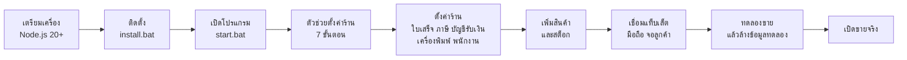

| ขั้น | ใช้เวลาโดยประมาณ | ใครทำ |
|---|---|---|
| ติดตั้ง | 10–15 นาที | ผู้ดูแลร้าน |
| ตัวช่วยตั้งค่า | 5 นาที | เจ้าของร้าน |
| ตั้งค่าร้าน เพิ่มสินค้า | 30 นาที – 2 ชั่วโมง (ขึ้นกับจำนวนสินค้า) | เจ้าของ / ผู้จัดการ |
| เชื่อมอุปกรณ์ ทดลองขาย | 30 นาที | ผู้จัดการ + พนักงาน |

---

## 2. เตรียมเครื่องและอุปกรณ์

### เครื่องหลัก (เครื่อง Host)

เครื่องหลักคือเครื่องที่ติดตั้งโปรแกรมและเก็บข้อมูลของร้าน เครื่องอื่นในร้านเชื่อมเข้ามาที่เครื่องนี้

| รายการ | ขั้นต่ำ | แนะนำ |
|---|---|---|
| ระบบปฏิบัติการ | Windows 10 / macOS 12 / Ubuntu 22.04 | Windows 10/11 64-bit |
| CPU / RAM | 2 คอร์ / 4 GB | 4 คอร์ / 8 GB |
| พื้นที่ว่าง | 2 GB | 10 GB ขึ้นไป (สำหรับไฟล์สำรอง) |
| เครือข่าย | Wi-Fi หรือ LAN วงเดียวกับอุปกรณ์อื่น | สาย LAN และตั้ง IP คงที่ที่เราเตอร์ |

ไม่ต้องใช้อินเทอร์เน็ตตอนขาย ใช้เฉพาะตอนติดตั้งและอัปเดต

### อุปกรณ์เสริม (ไม่บังคับ)

- **เครื่องพิมพ์ใบเสร็จ** 58 หรือ 80 มม. แบบ ESC/POS ผ่าน LAN/Wi-Fi (พอร์ต 9100) หรือ USB
- **ลิ้นชักเก็บเงิน** ต่อเข้ากับเครื่องพิมพ์ใบเสร็จ
- **เครื่องสแกนบาร์โค้ด** แบบ USB (ทำงานเหมือนคีย์บอร์ด)
- **แท็บเล็ต / มือถือ** สำหรับจุดขายที่สอง แอปรับออเดอร์ หรือจอลูกค้า

### โปรแกรมที่ต้องติดตั้งก่อน

1. **Node.js 20 ขึ้นไป** ดาวน์โหลดเวอร์ชัน LTS จาก <https://nodejs.org> แล้วกด Next จนเสร็จ
2. **Git** (ถ้าจะโคลนจาก GitHub) จาก <https://git-scm.com> หรือดาวน์โหลดเป็นไฟล์ ZIP จากหน้า GitHub แทนก็ได้

ตรวจว่าติดตั้งแล้ว: เปิด Command Prompt แล้วพิมพ์

```bash
node -v
```

ต้องเห็นเลข `v20` หรือสูงกว่า

---

## 3. ติดตั้งโปรแกรม

เลือกวิธีใดวิธีหนึ่ง

### วิธี A: โคลนจาก GitHub (Windows)

1. เปิด Command Prompt ในโฟลเดอร์ที่ต้องการติดตั้ง เช่น `C:\`
2. โคลนโปรแกรม

   ```bash
   git clone https://github.com/chakkrit4456/pos.git FlexPOS
   ```

   หรือกดปุ่ม **Code → Download ZIP** ในหน้า GitHub แล้วแตกไฟล์ไปที่ `C:\FlexPOS`

3. เปิดโฟลเดอร์ `C:\FlexPOS` แล้ว **ดับเบิลคลิก `install.bat`**
   รอจนขึ้น `[OK] ติดตั้งเสร็จแล้ว` (ครั้งแรกใช้เวลา 3–10 นาที ขึ้นกับความเร็วอินเทอร์เน็ต)
4. **ดับเบิลคลิก `start.bat`** โปรแกรมจะเปิดเบราว์เซอร์ไปที่ <http://localhost:4100> ให้อัตโนมัติ

> หน้าต่างสีดำของ `start.bat` คือตัวโปรแกรม **ห้ามปิด** ระหว่างเปิดร้าน ถ้าปิด เครื่องอื่นจะเชื่อมต่อไม่ได้

ถ้า Windows Firewall ถามเรื่องการเข้าถึงเครือข่ายของ Node.js ให้เลือก **อนุญาตในเครือข่ายส่วนตัว (Private)** เพื่อให้แท็บเล็ตและมือถือเชื่อมต่อได้

ข้อมูลทั้งหมดของร้านเก็บอยู่ที่โฟลเดอร์ `C:\FlexPOS\data` (ฐานข้อมูล ไฟล์สำรอง และการตั้งค่า)

### วิธี B: Linux / macOS

```bash
git clone https://github.com/chakkrit4456/pos.git FlexPOS
cd FlexPOS
sh install.sh
sh start.sh
```

แล้วเปิด <http://localhost:4100>

### วิธี C: ตัวติดตั้ง Windows (.exe)

ถ้าได้รับไฟล์ `FlexPOS-Setup.exe` จากผู้จำหน่าย ให้ดับเบิลคลิกแล้วกด Next จนเสร็จ ไม่ต้องติดตั้ง Node.js
Windows อาจเตือน "Unknown publisher" ให้กด **More info → Run anyway**
ข้อมูลเก็บที่ `%APPDATA%\FlexPOS\data`

> ผู้จำหน่ายสร้างไฟล์นี้ได้ด้วยคำสั่ง `corepack pnpm desktop:dist` (ไฟล์ออกที่ `apps/desktop/release`)

### วิธี D: Docker (เซิร์ฟเวอร์ / หลายสาขา)

แก้รหัสผ่านใน `docker-compose.yml` ก่อน แล้วรัน

```bash
docker compose up -d --build
```

เปิด `http://<IP เซิร์ฟเวอร์>:4100` รายละเอียดเพิ่มเติมดู [คู่มือติดตั้งและเชื่อมฐานข้อมูล](../install-guide.md)

### ให้โปรแกรมเปิดเองเมื่อเปิดเครื่อง (Windows)

1. กด `Win + R` พิมพ์ `shell:startup` แล้วกด Enter
2. คลิกขวาที่ `start.bat` ในโฟลเดอร์ FlexPOS → **Create shortcut**
3. ลากไฟล์ shortcut ที่ได้ไปวางในโฟลเดอร์ Startup ที่เปิดอยู่

---

## 4. ตัวช่วยตั้งค่าร้าน 7 ขั้นตอน

เปิดโปรแกรมครั้งแรกจะเห็นตัวช่วยตั้งค่าร้าน ทุกค่าแก้ไขภายหลังได้ที่เมนู **ตั้งค่า**

### ขั้นที่ 1: ภาษา

เลือกภาษาของโปรแกรม แล้วกด **ถัดไป**

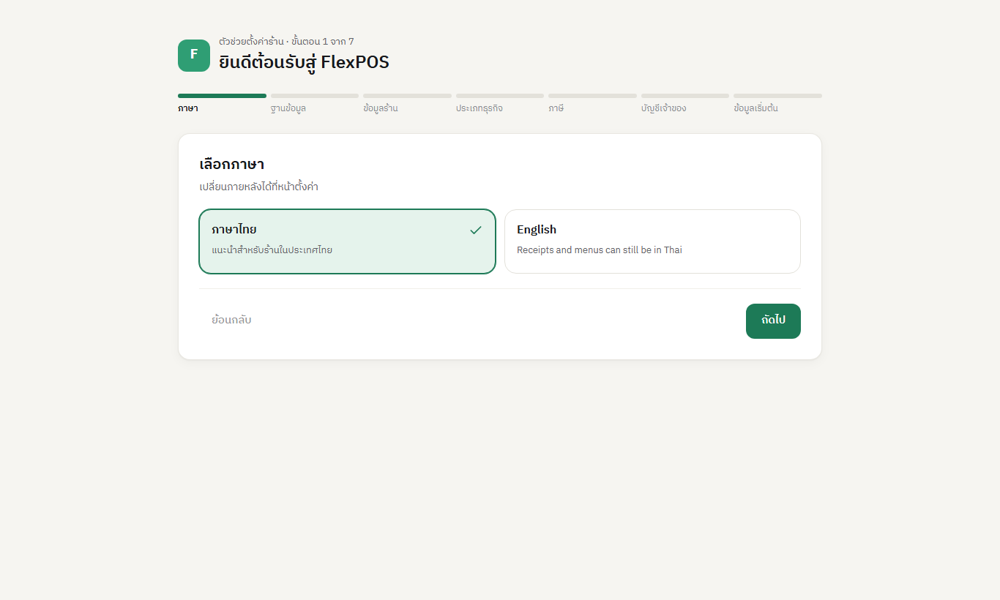

### ขั้นที่ 2: ฐานข้อมูล

| ตัวเลือก | เหมาะกับ |
|---|---|
| **เก็บในเครื่องนี้** (แนะนำ) | ร้านเดียว 1–5 เครื่อง ใช้งานได้ทันทีไม่ต้องตั้งค่าเพิ่ม |
| **ฐานข้อมูลของฉัน** | มีเซิร์ฟเวอร์ PostgreSQL / MySQL อยู่แล้ว หรือหลายสาขา |
| **เชื่อมเครื่อง Host** | เครื่องนี้เป็นจุดขายเพิ่ม ให้เชื่อมเข้ากับเครื่องหลักที่ติดตั้งไว้แล้ว |

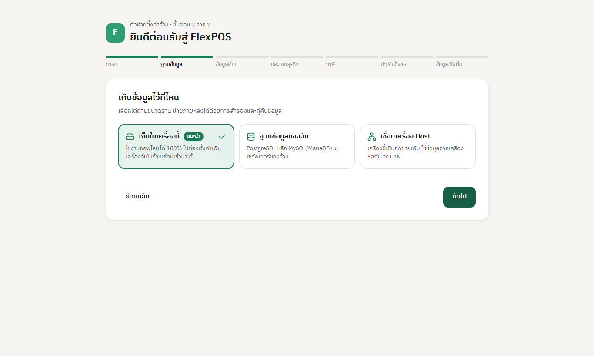

### ขั้นที่ 3: ข้อมูลร้าน

กรอกชื่อร้าน สาขา เบอร์โทร ที่อยู่ เลขผู้เสียภาษี (ถ้ามี) และ **หมายเลข PromptPay** (เบอร์มือถือหรือเลขผู้เสียภาษีที่ผูกกับบัญชีร้าน) ข้อมูลนี้จะพิมพ์บนใบเสร็จ

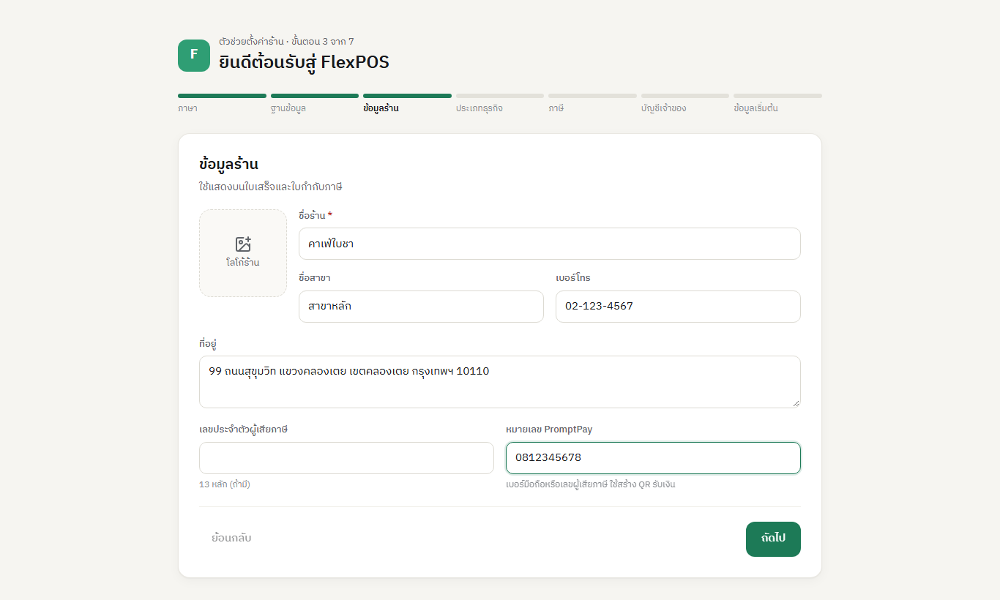

### ขั้นที่ 4: ประเภทธุรกิจ

เลือกประเภทร้าน ระบบจะเปิดโมดูลที่เหมาะให้ เช่น ร้านอาหาร/คาเฟ่ จะเปิดระบบโต๊ะ ส่งครัว และแอปรับออเดอร์

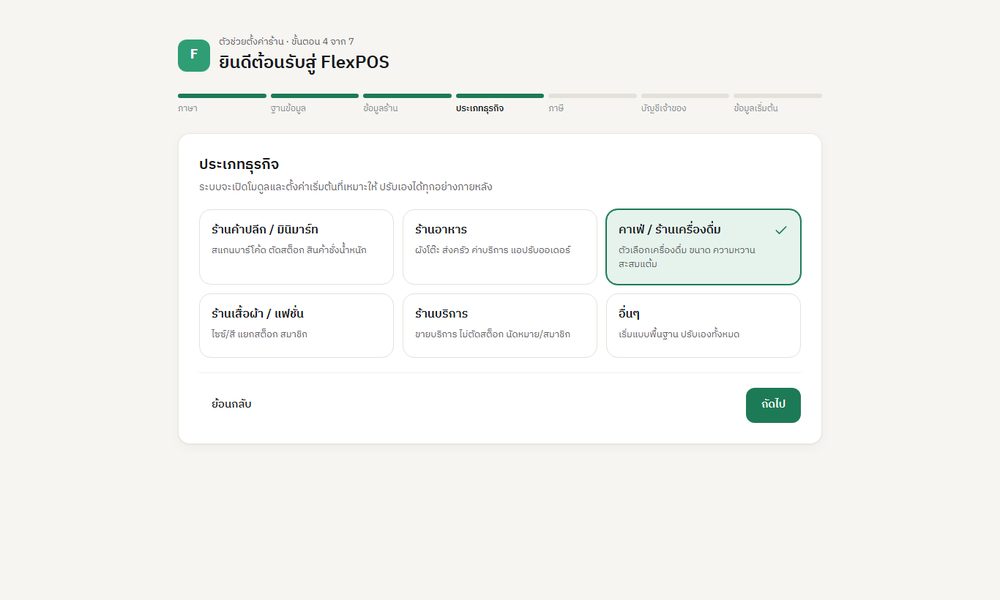

### ขั้นที่ 5: ภาษี

ตั้งว่าร้านจดทะเบียน VAT หรือไม่ อัตรา VAT ราคาสินค้ารวม VAT แล้วหรือยัง และค่าบริการ (Service charge)

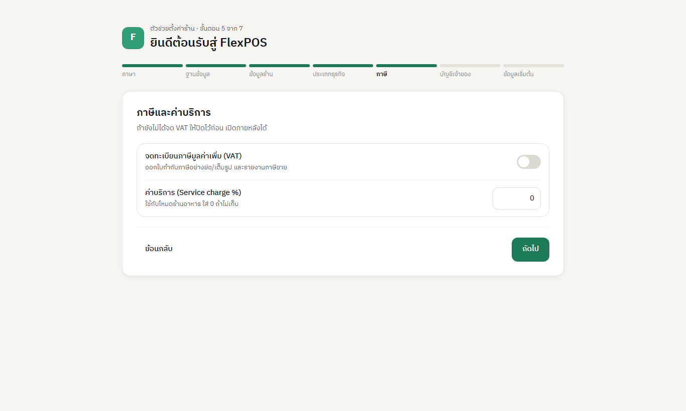

### ขั้นที่ 6: บัญชีเจ้าของ

สร้างบัญชีของเจ้าของร้าน ซึ่งมีสิทธิ์ทุกอย่าง

- **ชื่อผู้ใช้ + รหัสผ่าน** ใช้เข้าหน้าหลังร้าน
- **PIN 4–6 หลัก** ใช้เข้าหน้าขายและอนุมัติรายการแทนผู้จัดการ ห้ามใช้ PIN ที่เดาง่าย เช่น 0000 หรือ 1234

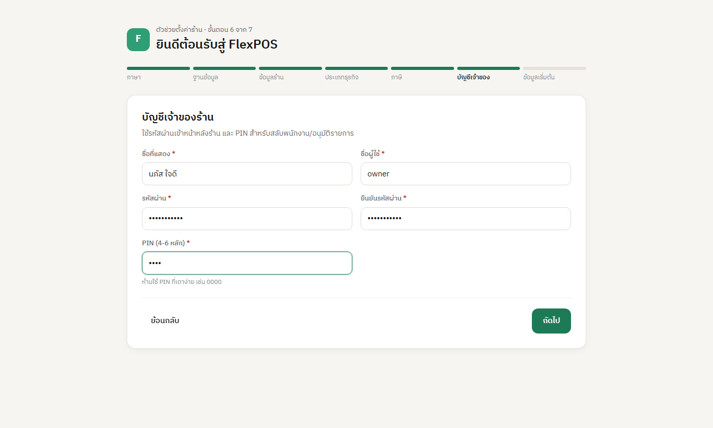

> จดชื่อผู้ใช้ รหัสผ่าน และ PIN เก็บไว้ในที่ปลอดภัย

### ขั้นที่ 7: ข้อมูลเริ่มต้น

- **ใส่ข้อมูลตัวอย่าง**: มีสินค้า หมวด และโต๊ะตัวอย่างให้ลองใช้ เหมาะกับการทดลองก่อนเปิดร้าน
- **เริ่มจากร้านว่าง**: เริ่มเพิ่มสินค้าของร้านเองทันที

กด **เริ่มใช้งาน** เป็นอันเสร็จ

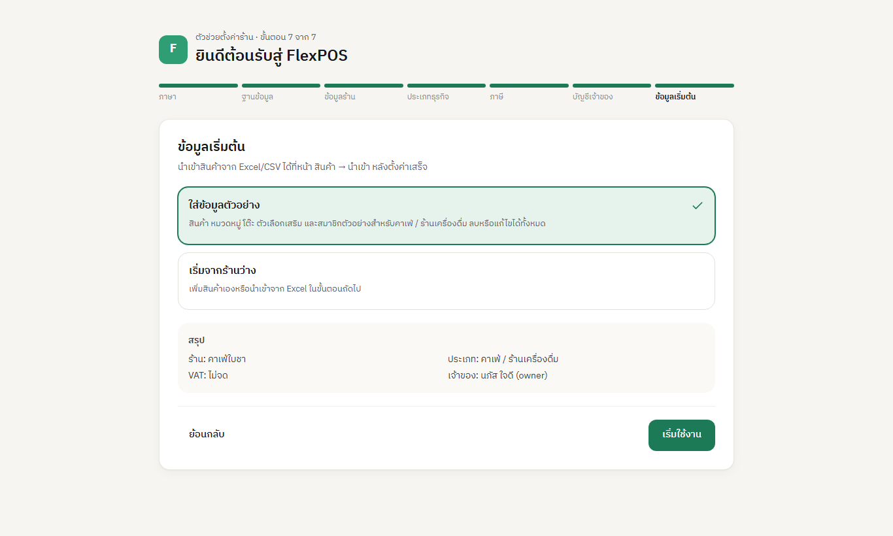

---

## 5. เข้าสู่ระบบ

มี 2 แบบ

- **PIN พนักงาน** สำหรับหน้าขาย แตะเลข PIN 4 หลักเพื่อเข้าใช้งานหรือสลับพนักงาน
- **ชื่อผู้ใช้ / รหัสผ่าน** สำหรับเข้าหน้าหลังร้านจากเครื่องอื่น

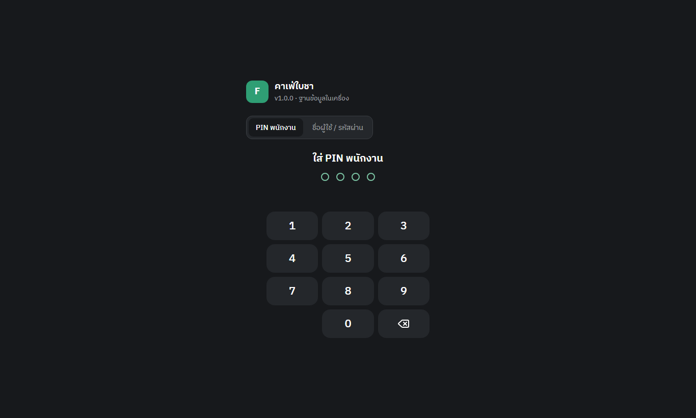

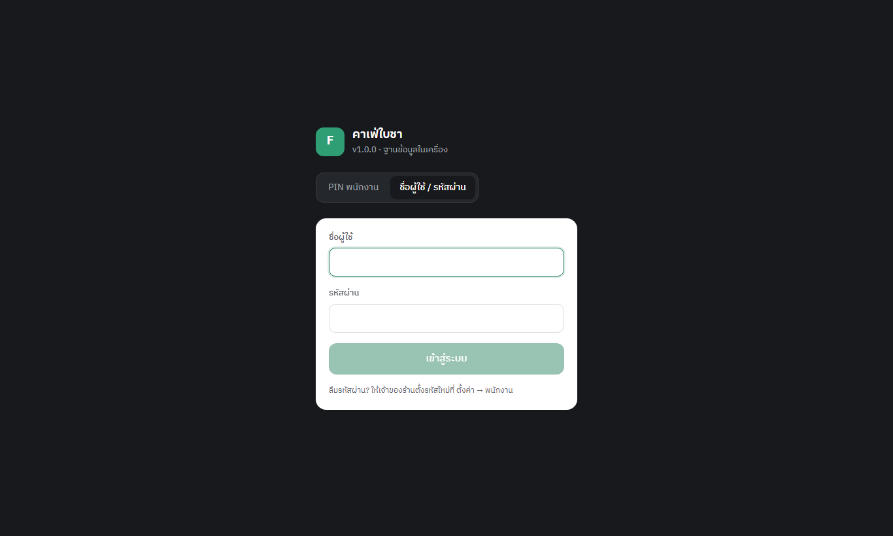

ถ้าไม่ได้ใช้งานสักพัก หน้าจอจะล็อกเอง ใส่ PIN เพื่อกลับมาใช้งานต่อ (ตั้งเวลาได้ที่ ตั้งค่า → หน้าขาย)

---

## 6. ตั้งค่าก่อนเปิดร้าน

ไปที่เมนู **ตั้งค่า** (รูปเฟือง) แล้วตั้งค่าตามลำดับนี้ ทุกหน้ามีปุ่ม **บันทึก** ด้านล่าง

### 6.1 ข้อมูลร้าน

แก้ชื่อร้าน ที่อยู่ เบอร์โทร โลโก้ และเลขผู้เสียภาษี

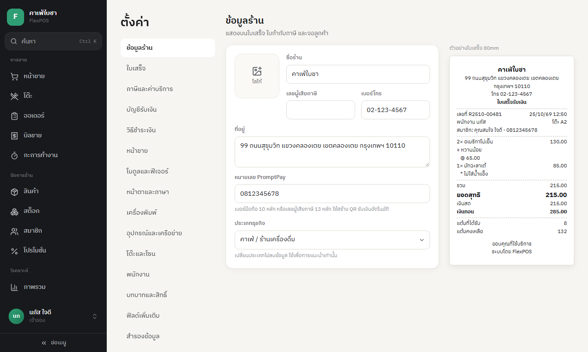

### 6.2 ใบเสร็จ

ลากจัดลำดับส่วนต่างๆ ของใบเสร็จ เลือกขนาดกระดาษ 58/80 มม. หรือ A4 และดูตัวอย่างได้ทันที

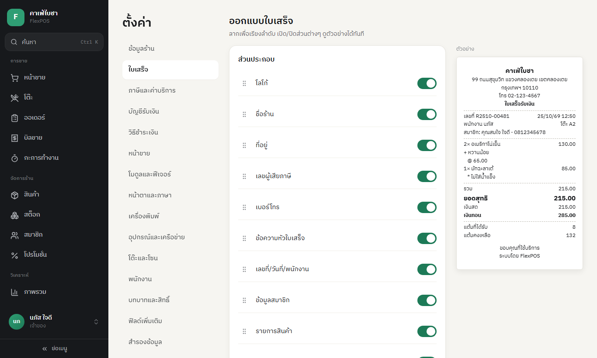

### 6.3 ภาษีและค่าบริการ

VAT, ค่าบริการ, การปัดเศษ และใบกำกับภาษี

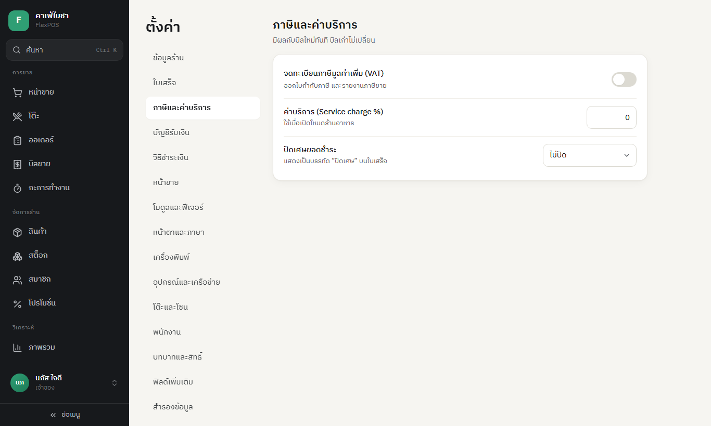

### 6.4 บัญชีรับเงิน (สำคัญ)

เพิ่มบัญชีธนาคารของร้านเพื่อให้ระบบสร้าง **QR PromptPay ที่ระบุยอดเงินแล้ว** ลูกค้าสแกนจ่ายได้ทันทีโดยไม่ต้องพิมพ์ยอดเอง

1. กด **เพิ่มบัญชี** → เลือกธนาคาร (รองรับธนาคารไทยทุกแห่ง TrueMoney และธนาคารต่างประเทศ)
2. กรอกชื่อบัญชี เลขที่บัญชี และ **หมายเลข PromptPay** ที่ผูกกับบัญชีนี้
3. บัญชีต่างประเทศให้กรอก SWIFT / IBAN
4. ตั้ง **บัญชีหลัก** และกด **บันทึก**
5. ลองสแกน **QR ทดสอบ ฿100** ด้วยแอปธนาคาร ตรวจว่าชื่อบัญชีที่แอปแสดงถูกต้อง (ไม่ต้องกดโอนจริง)

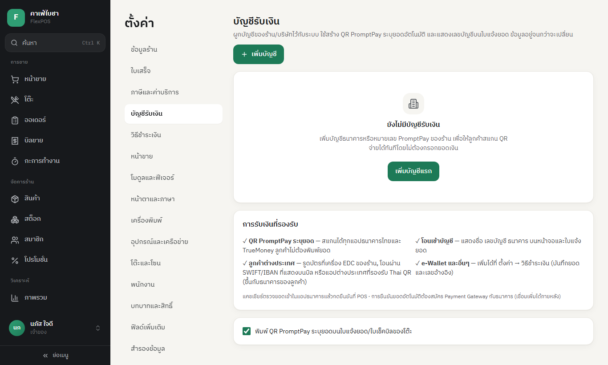

> ข้อมูลบัญชีเก็บไว้ในเครื่องจนกว่าจะแก้ไข ถ้าเปลี่ยนบัญชีร้าน ต้องแก้ที่หน้านี้ทันที

### 6.5 วิธีชำระเงิน

เปิด/ปิดวิธีชำระที่ร้านรับ และกดเพิ่มวิธีสำเร็จรูปได้ในคลิกเดียว เช่น บัตรเครดิต (เครื่อง EDC), TrueMoney, ShopeePay, LINE Pay, Alipay, WeChat Pay, โอนต่างประเทศ, เช็ค, บัตรกำนัล

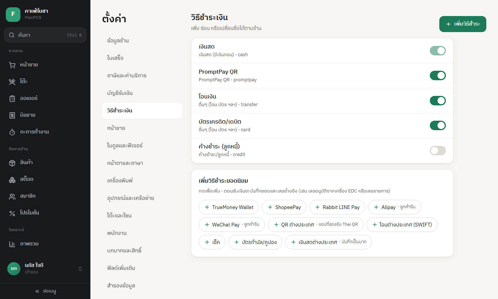

### 6.6 หน้าขายและโมดูล

ตั้งเวลาล็อกหน้าจอ ปุ่มด่วน และเปิด/ปิดโมดูล เช่น ร้านอาหาร สต็อก สมาชิก จอลูกค้า หลายสาขา

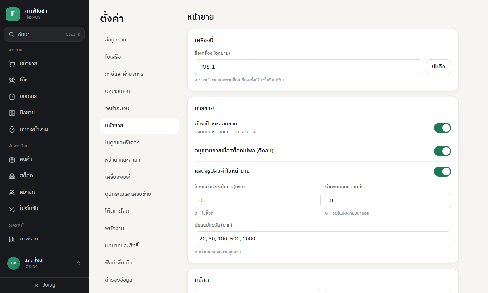

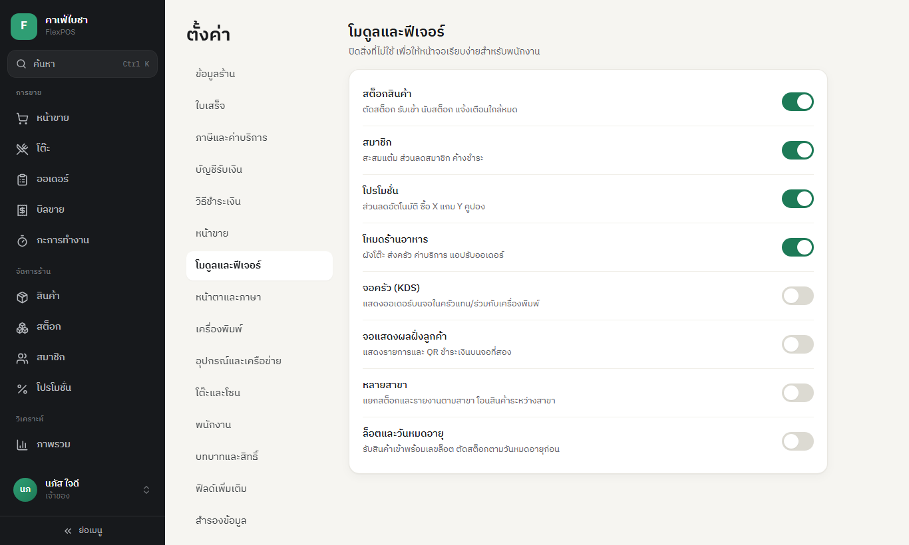

### 6.7 หน้าตาและภาษา

เปลี่ยนชื่อแอป โลโก้ สีหลัก สีแถบเมนู ธีมสว่าง/มืด ข้อความหน้าเข้าสู่ระบบ และภาษา มีตัวอย่างให้ดูก่อนบันทึก

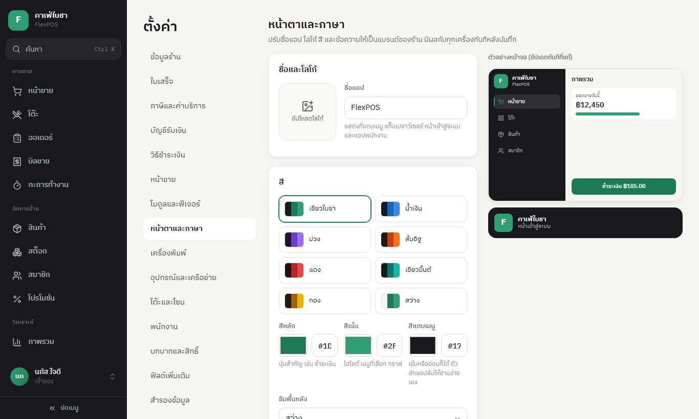

### 6.8 เครื่องพิมพ์

1. เปิดเครื่องพิมพ์และต่อเข้าเครือข่ายเดียวกับเครื่องหลัก
2. กด **ค้นหาในเครือข่าย** หรือกรอก IP ของเครื่องพิมพ์
3. เลือกหน้าที่: ใบเสร็จ ครัว หรือบาร์
4. กด **ทดสอบพิมพ์** ถ้าภาษาไทยเพี้ยน ให้เลือก **โหมดภาพ** (พิมพ์ไทยได้ทุกรุ่น)

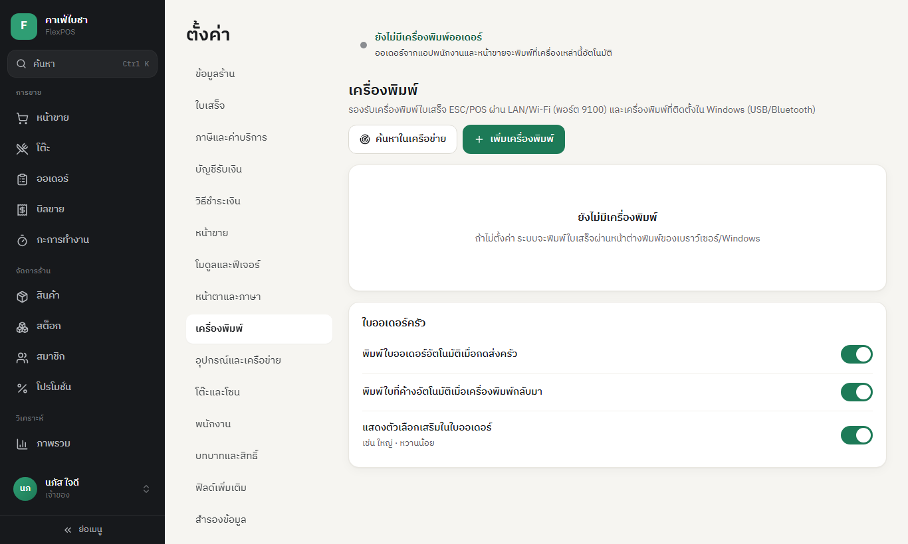

### 6.9 โต๊ะและโซน (ร้านอาหาร/คาเฟ่)

สร้างโซน เช่น "ในร้าน" "ระเบียง" แล้วเพิ่มโต๊ะในแต่ละโซน ชื่อโต๊ะซ้ำกันข้ามโซนได้ ระบบจะแสดงเป็น "โซน · โต๊ะ" เสมอ

> ลบโซน = ลบโต๊ะทั้งหมดในโซนนั้น และ **ปิดบิลที่ค้างอยู่** ระบบจะเตือนก่อนลบเสมอ

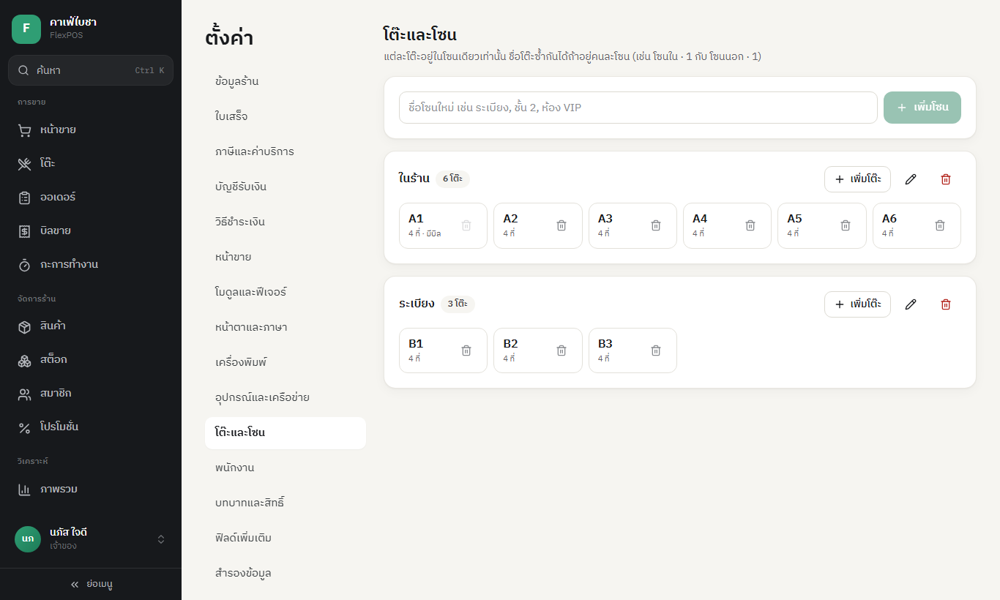

### 6.10 พนักงาน บทบาท และสิทธิ์

1. ที่ **บทบาทและสิทธิ์** กำหนดว่าแต่ละตำแหน่งทำอะไรได้ เช่น แคชเชียร์ยกเลิกบิลไม่ได้
2. ที่ **พนักงาน** เพิ่มพนักงานแต่ละคนพร้อม PIN ของตัวเอง

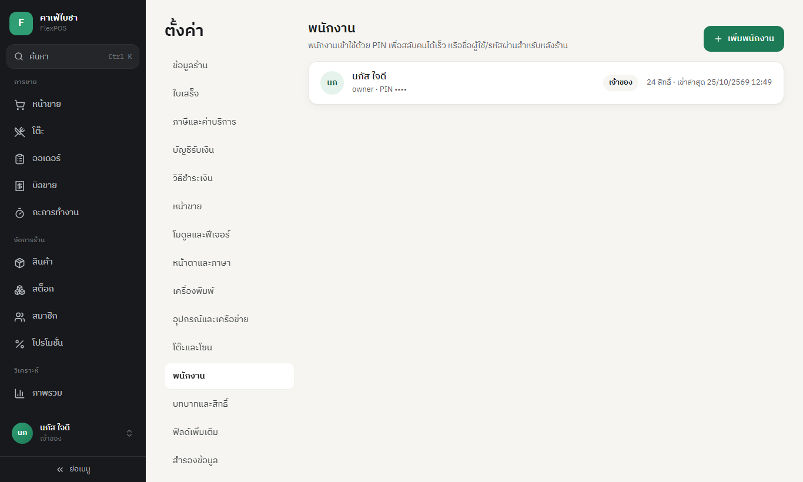

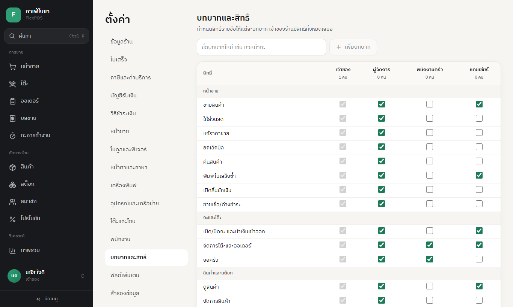

เมื่อพนักงานทำรายการที่ไม่มีสิทธิ์ เช่น ลดราคา ยกเลิกบิล ระบบจะขอ **PIN ผู้จัดการ** และบันทึกไว้ใน **บันทึกการใช้งาน**

### 6.11 ฟิลด์เพิ่มเติม (ถ้าต้องการ)

เพิ่มช่องข้อมูลของร้านเอง เช่น "ประกัน" ของสินค้า หรือ "วันเกิด" ของสมาชิก

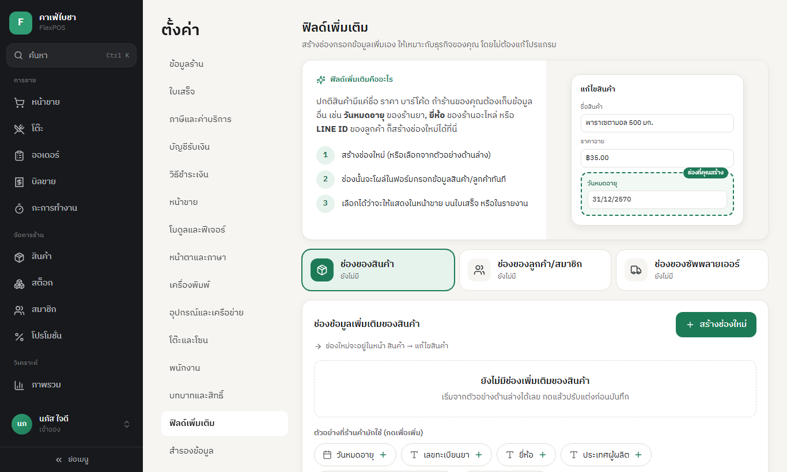

### 6.12 สำรองข้อมูล (ต้องตั้ง)

1. เลือก **ไดรฟ์/โฟลเดอร์** สำหรับเก็บไฟล์สำรอง แนะนำแฟลชไดรฟ์ ไดรฟ์อื่น หรือโฟลเดอร์ที่ซิงก์ OneDrive / Google Drive
2. เปิด **สำรองอัตโนมัติ** (ค่าเริ่มต้นทุก 24 ชั่วโมง เก็บ 14 ไฟล์ล่าสุด)
3. กด **สำรองตอนนี้** หนึ่งครั้งเพื่อทดสอบ

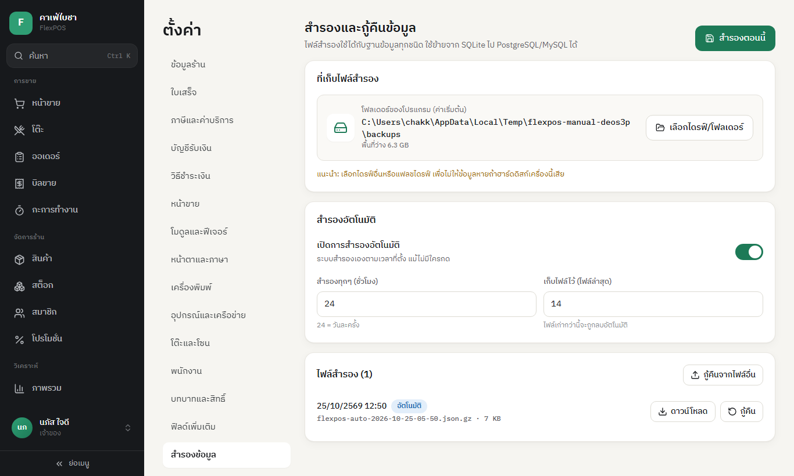

### 6.13 License

เครื่องใหม่ทดลองใช้ได้ 14 วัน ส่ง **Machine ID** ในหน้านี้ให้ผู้จำหน่ายเพื่อรับ License key แล้ววาง key และกด **เปิดใช้งาน** (ตรวจสอบในเครื่อง ไม่ต้องต่ออินเทอร์เน็ต)

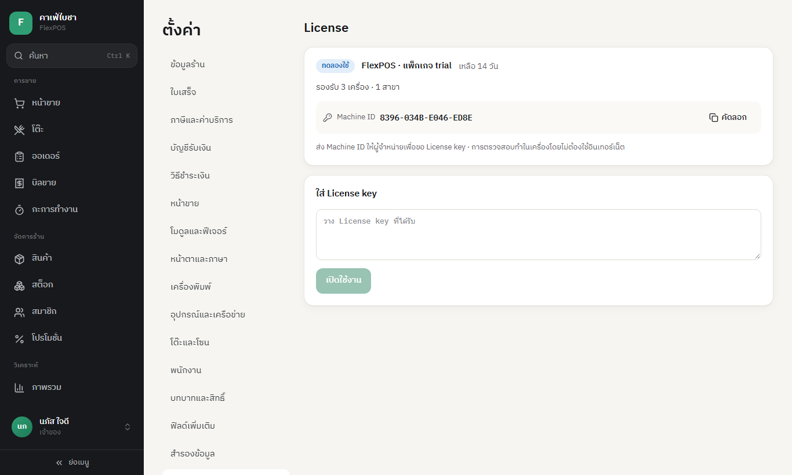

---

## 7. เพิ่มสินค้า หมวดหมู่ และสต็อก

### หมวดหมู่

**สินค้า → แท็บหมวดหมู่** เพิ่ม แก้ชื่อ ลากจัดลำดับ หรือลบหมวด
ถ้าหมวดที่จะลบยังมีสินค้า ระบบจะให้เลือกว่าจะย้ายสินค้าไปหมวดไหน

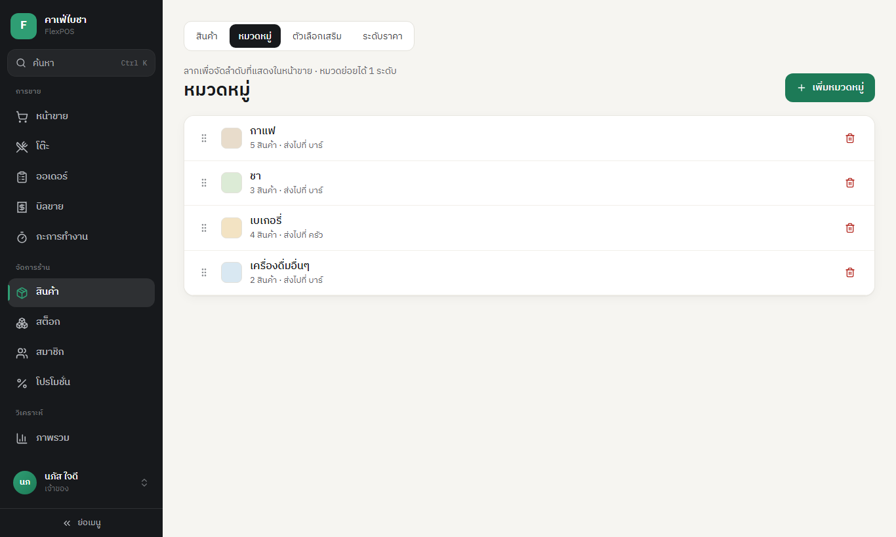

### สินค้า

**สินค้า → เพิ่มสินค้า** กรอกชื่อ SKU หมวด ราคา ต้นทุน และบาร์โค้ด เลือกตัวเลือกเสริม (ขนาด ความหวาน ท็อปปิ้ง) และตัวเลือกสินค้า (ไซซ์/สี) ได้

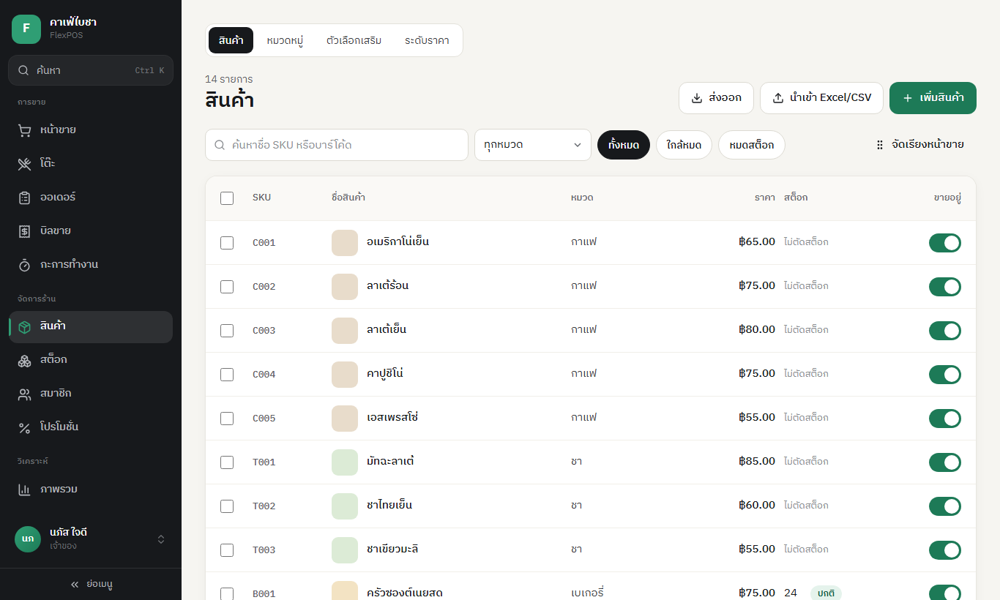

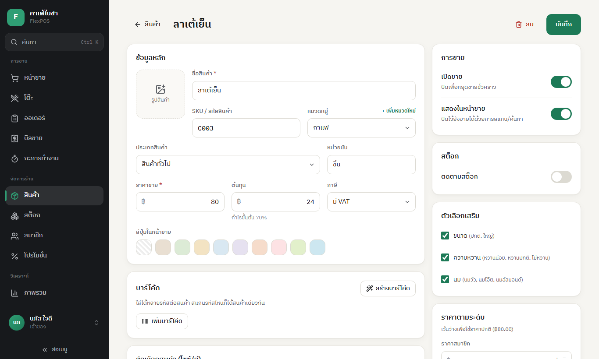

มีสินค้าเยอะ: กด **นำเข้า Excel/CSV** ดาวน์โหลดไฟล์ตัวอย่าง กรอกข้อมูล แล้วอัปโหลด ระบบจะตรวจข้อมูลให้ก่อนบันทึก

### สต็อก

เปิด **ติดตามสต็อก** ที่สินค้าแต่ละตัว แล้วไปที่ **สต็อก** เพื่อรับสินค้าเข้า ปรับ (ต้องระบุเหตุผล) หรือนับสต็อก

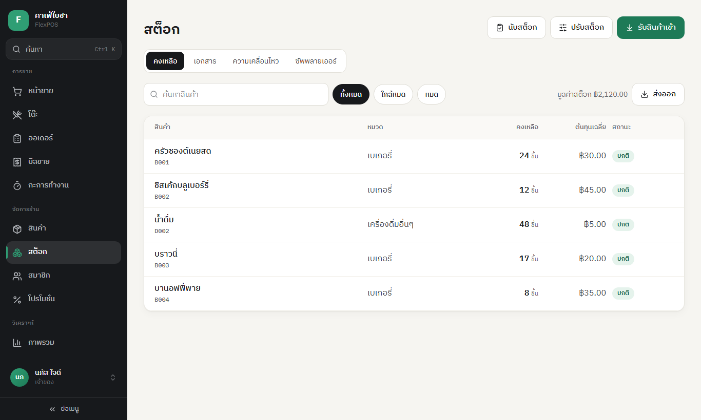

---

## 8. เชื่อมแท็บเล็ต มือถือ และจอลูกค้า

ไปที่ **ตั้งค่า → อุปกรณ์และเครือข่าย** จะเห็นที่อยู่ของเครื่องหลัก (เช่น `http://192.168.1.44:4100`) และ QR สำหรับแต่ละอุปกรณ์

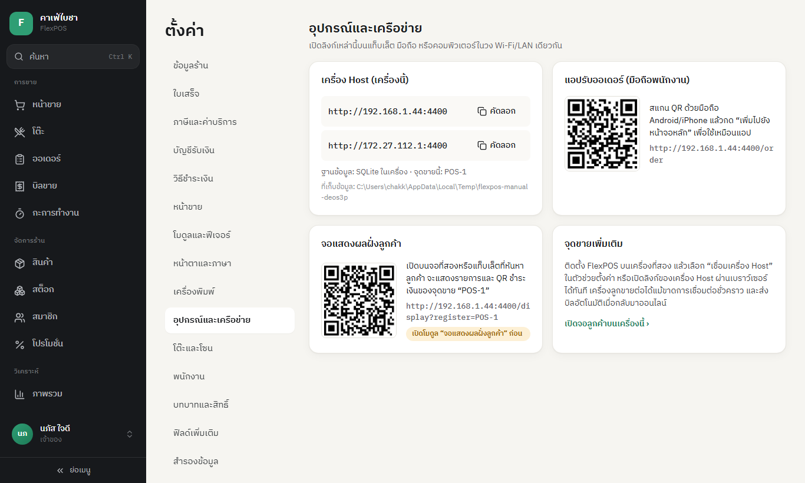

| อุปกรณ์ | วิธีเชื่อม |
|---|---|
| **จุดขายเพิ่ม / แท็บเล็ตแคชเชียร์** | เปิดเบราว์เซอร์ไปที่ที่อยู่ของเครื่องหลัก แล้วเข้าสู่ระบบด้วย PIN |
| **แอปรับออเดอร์ (มือถือพนักงาน)** | สแกน QR "แอปรับออเดอร์" แล้วกด **เพิ่มไปยังหน้าจอหลัก** เพื่อใช้เหมือนแอป |
| **จอลูกค้า** | สแกน QR "จอแสดงผลฝั่งลูกค้า" บนแท็บเล็ตที่หันหาลูกค้า (เปิดโมดูลจอลูกค้าก่อน) |

ทุกอุปกรณ์ต้องอยู่ใน Wi-Fi/LAN วงเดียวกับเครื่องหลัก แนะนำตั้ง IP คงที่ให้เครื่องหลักที่เราเตอร์ ไม่อย่างนั้นที่อยู่อาจเปลี่ยนเมื่อรีสตาร์ตเราเตอร์

แท็บเล็ต (แนวนอน):

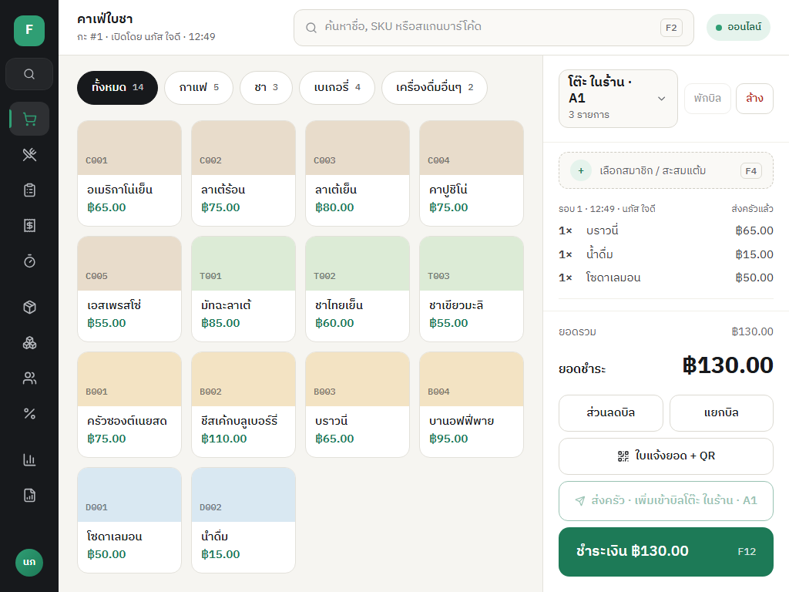

มือถือพนักงาน:

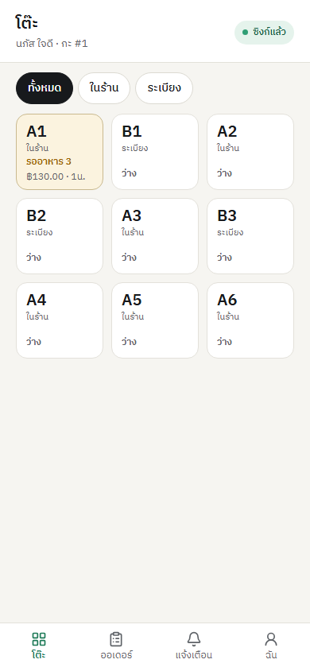 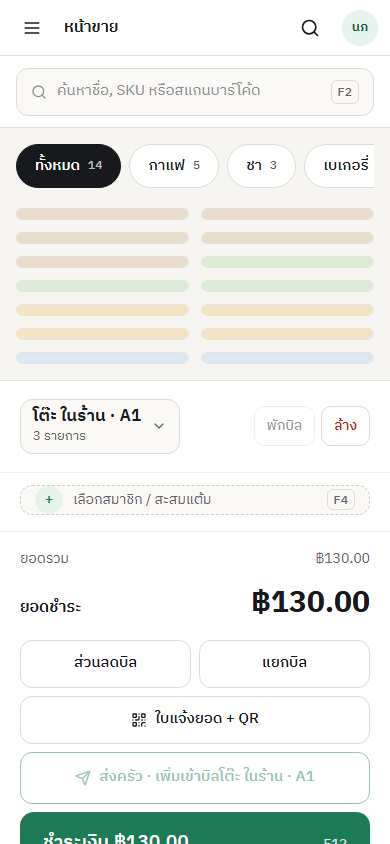

---

## 9. การทำงานในแต่ละวัน

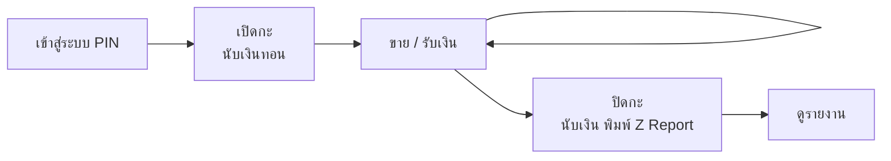

### 9.1 เปิดกะ

เข้าหน้าขายครั้งแรกของวันจะขอให้เปิดกะ นับเงินทอนในลิ้นชักแล้วกรอกยอด → **เปิดกะ**

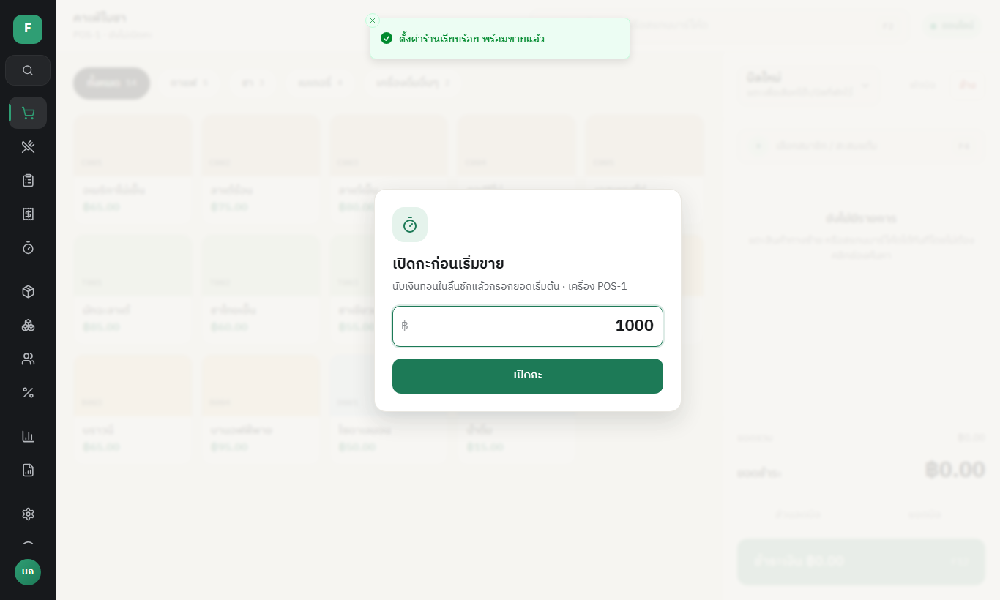

### 9.2 ขายสินค้า

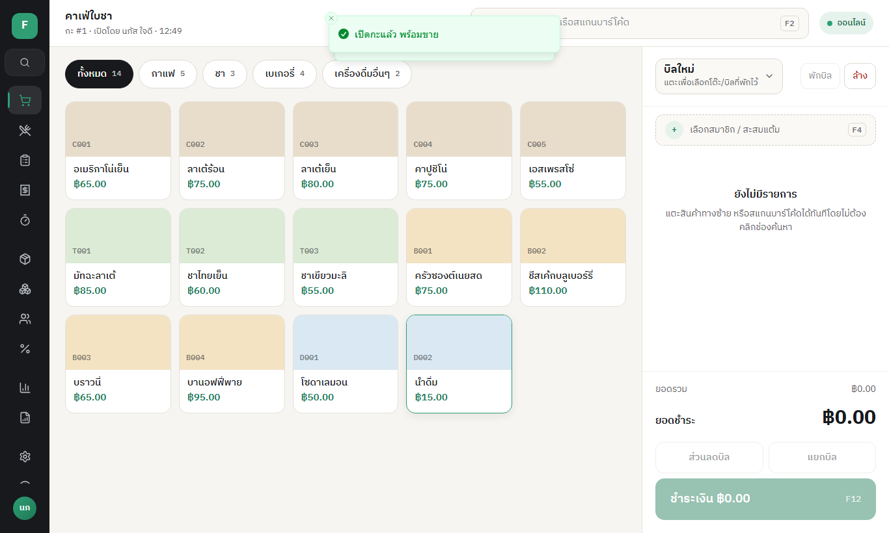

- แตะสินค้า หรือ **สแกนบาร์โค้ดได้เลย** ไม่ต้องคลิกช่องค้นหา
- ค้นหาด้วยชื่อหรือ SKU (กด F2)
- สินค้าที่มีตัวเลือกจะมีหน้าต่างให้เลือก เช่น ขนาด ความหวาน

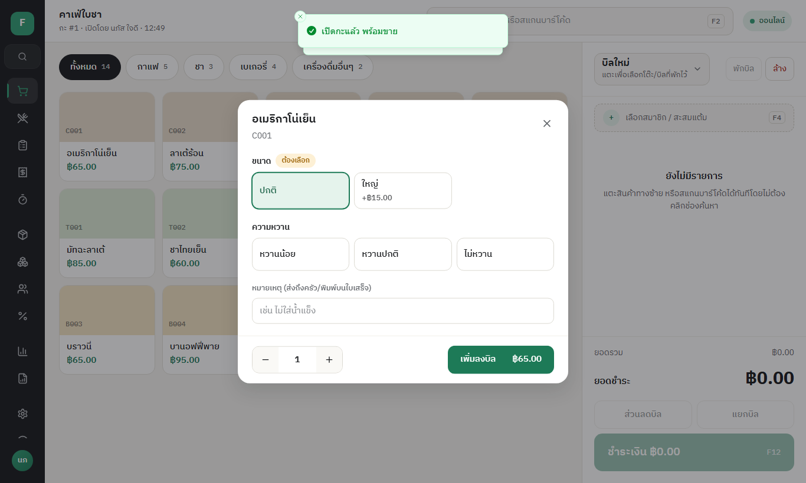

- แตะรายการในตะกร้าเพื่อแก้จำนวน ราคา ส่วนลด หรือหมายเหตุ
- **เลือกสมาชิก** (F4) เพื่อสะสมแต้ม
- **ส่วนลดบิล / คูปอง** (F8) · **พักบิล** (F6) · **เลือกโต๊ะ/บิลที่พักไว้** (F7)

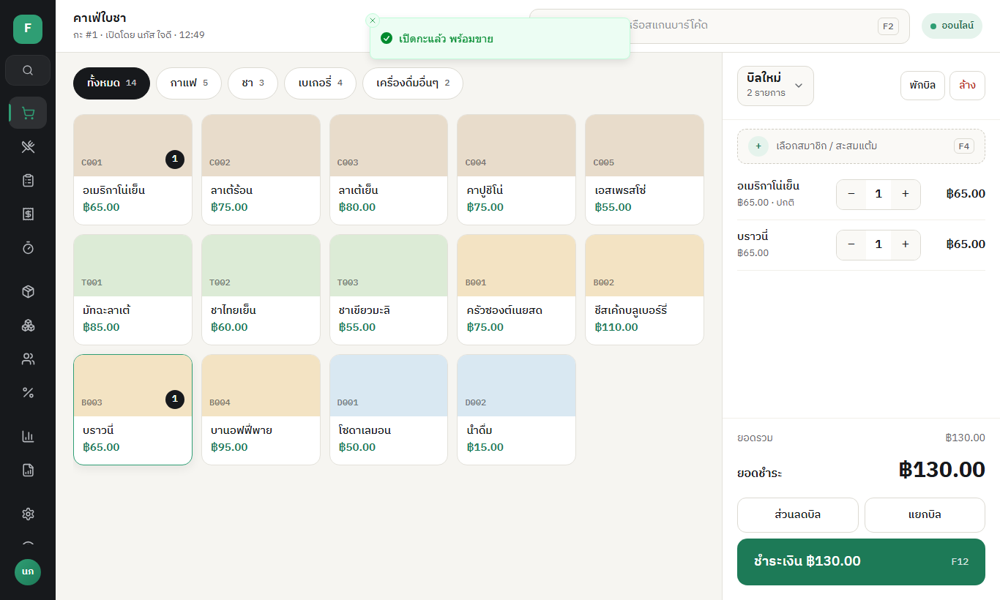

### 9.3 รับเงิน (F12)

| วิธี | ขั้นตอน |
|---|---|
| **เงินสด** | กดปุ่มธนบัตรหรือพิมพ์จำนวนเงินที่รับ ระบบแสดงเงินทอน → **ยืนยันการชำระ** |
| **PromptPay QR** | ลูกค้าสแกน QR ซึ่งระบุยอดไว้แล้ว → **ตรวจยอดเข้าในแอปธนาคารของร้าน** → ยืนยัน |
| **โอนเงิน** | หน้าจอแสดงชื่อบัญชี ธนาคาร และเลขบัญชีให้ลูกค้าโอน → ตรวจยอด → ยืนยัน |
| **บัตร / อื่นๆ** | รูดบัตรที่เครื่อง EDC แล้วกรอกเลขอ้างอิง → ยืนยัน |
| **แบ่งจ่าย** | ใส่ยอดวิธีแรก → แบ่งจ่าย → เลือกวิธีถัดไป |

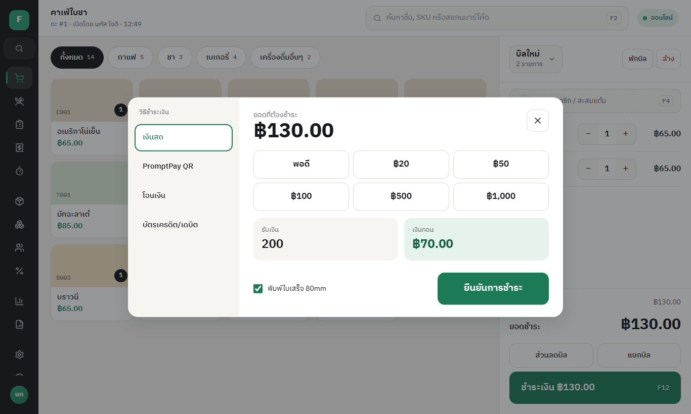

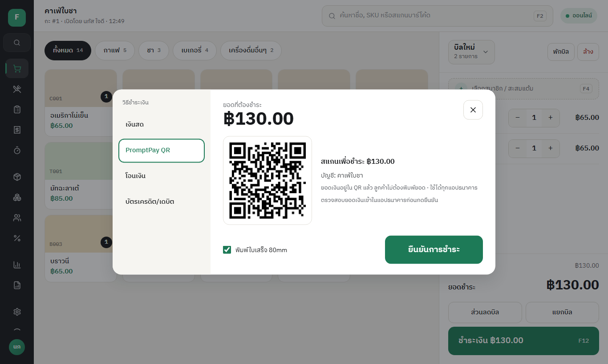

> ระบบไม่ได้ยืนยันยอดเงินเข้าให้อัตโนมัติ แคชเชียร์ต้อง **ตรวจว่าเงินเข้าบัญชีร้านจริง** ก่อนกดยืนยันทุกครั้ง

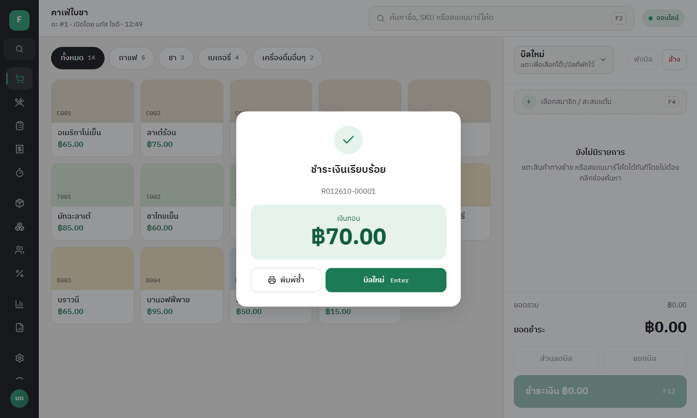

กด Enter เพื่อเริ่มบิลใหม่

### 9.4 บิลขาย คืนสินค้า ยกเลิกบิล

ที่เมนู **บิลขาย** ค้นหาบิล พิมพ์ซ้ำ ยกเลิกบิล คืนสินค้า หรือออกใบกำกับภาษีเต็มรูปย้อนหลัง

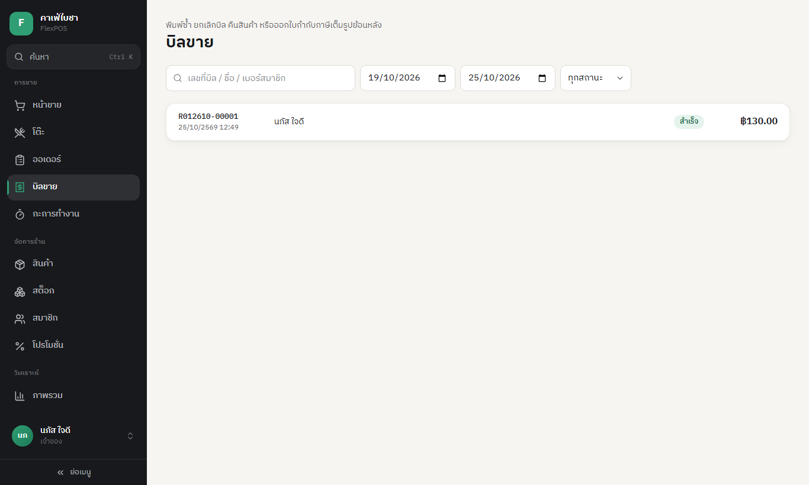

### 9.5 ปิดกะ

เมนู **กะการทำงาน → ปิดกะ** นับเงินในลิ้นชัก ระบบคำนวณส่วนต่างให้ แล้วพิมพ์ Z Report

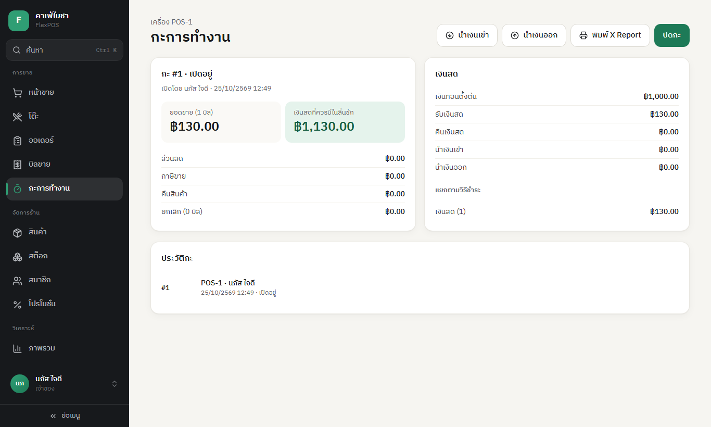

---

## 10. ร้านอาหารและคาเฟ่: โต๊ะ ส่งครัว ใบแจ้งยอด


### 10.1 เปิดโต๊ะและสั่งอาหาร

หน้า **โต๊ะ** แสดงทุกโต๊ะแยกตามโซน แตะโต๊ะว่างเพื่อเปิดบิล

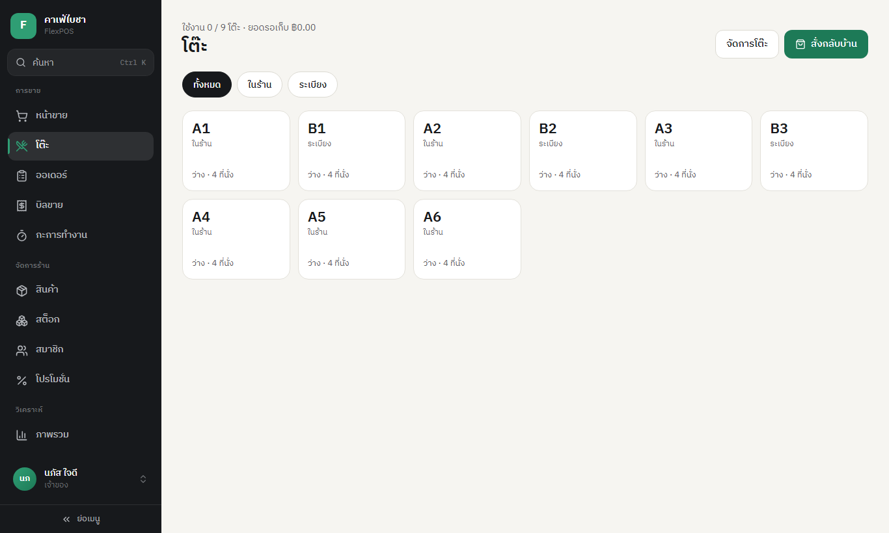

เลือกเมนูแล้วกด **ส่งครัว** รายการจะไปที่ครัว/บาร์ และเพิ่มเข้าบิลของโต๊ะ

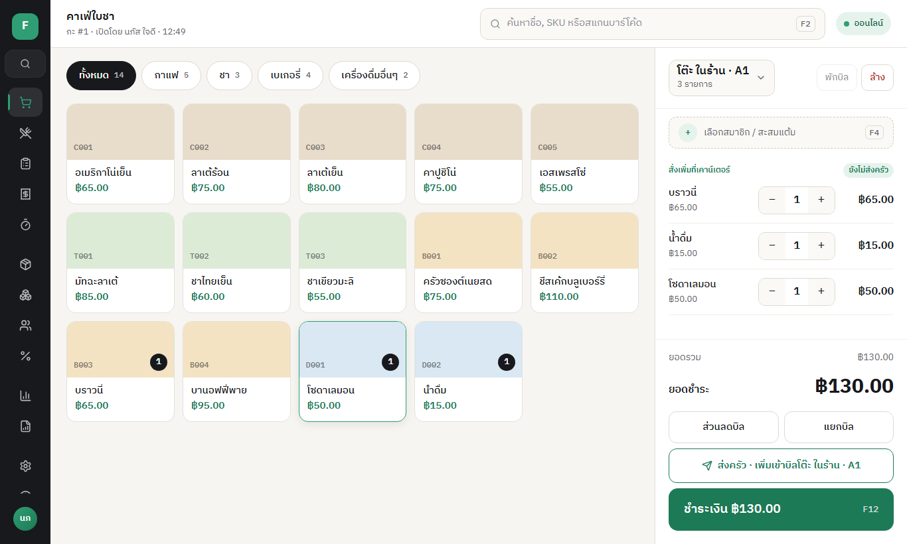

### 10.2 ติดตามออเดอร์

หน้า **ออเดอร์** แตะโต๊ะเพื่อดูรายละเอียดบิลแบบสด รายการเปลี่ยนทันทีเมื่อมีคนสั่งเพิ่มหรือลบ ผู้จัดการลบหรือลดจำนวนรายการได้ (ต้องระบุเหตุผล)

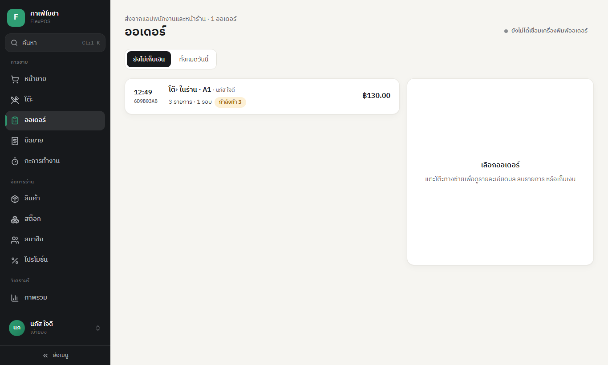

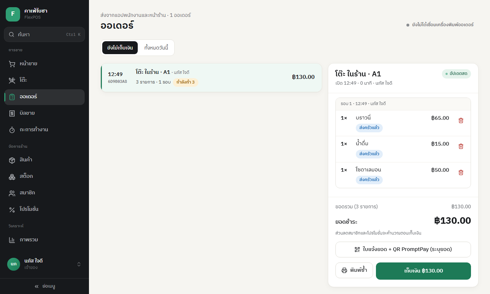

### 10.3 จอครัว

ที่ **จอครัว** แตะรายการเพื่อเปลี่ยนสถานะ ใหม่ → กำลังทำ → พร้อมเสิร์ฟ พนักงานเสิร์ฟได้รับแจ้งเตือนในแอปมือถือ

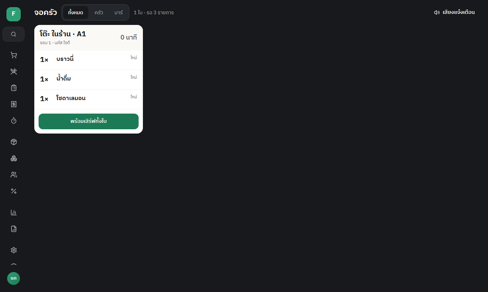

### 10.4 เช็กบิลด้วยใบแจ้งยอด + QR

กด **ใบแจ้งยอด + QR PromptPay (ระบุยอด)** ที่บิลของโต๊ะ จะได้ใบแจ้งยอดที่มีรายการอาหาร ยอดชำระ และ QR ที่ระบุยอดแล้ว

- **พิมพ์ใบแจ้งยอด** ไปที่เครื่องพิมพ์ใบเสร็จ (ถ้าไม่มีเครื่องพิมพ์ จะเปิดหน้าพิมพ์ของเบราว์เซอร์)
- **แสดงบนจอลูกค้า** ให้ลูกค้าสแกนจากจอ
- ใบแจ้งยอด **ไม่ใช่ใบเสร็จรับเงิน** เมื่อได้รับเงินแล้วให้กด **เก็บเงิน** เพื่อออกใบเสร็จ

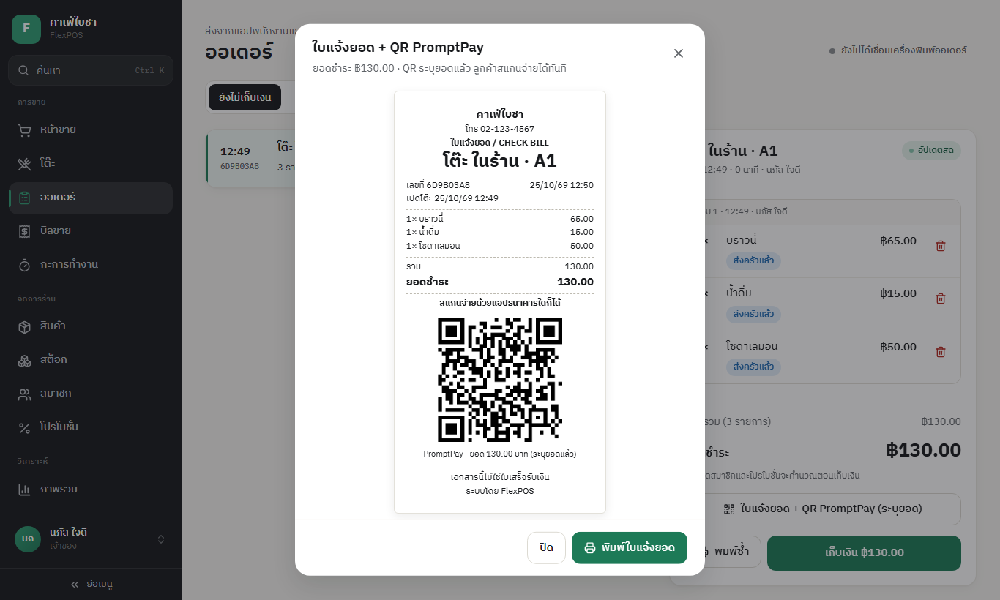

---

## 11. หลังร้าน: รายงาน สมาชิก โปรโมชั่น

| เมนู | ใช้ทำอะไร |
|---|---|
| **ภาพรวม** | ยอดขายวันนี้ / 7 วัน / 30 วัน, สินค้าขายดี, ยอดตามชั่วโมง |
| **รายงาน** | ยอดขายตามวัน สินค้า หมวด พนักงาน วิธีชำระ, กำไรขั้นต้น, ภาษีขาย, ส่งออก Excel/CSV/PDF |
| **สมาชิก** | ข้อมูลลูกค้า แต้มสะสม ระดับสมาชิก ยอดค้างชำระ |
| **โปรโมชั่น** | ลด % / บาท, ซื้อ X แถม Y, ซื้อครบยอด, ช่วงเวลาพิเศษ, คูปอง |
| **บันทึกการใช้งาน** | ใครทำอะไรเมื่อไร เช่น ยกเลิกบิล ลดราคา เปลี่ยนการตั้งค่า |

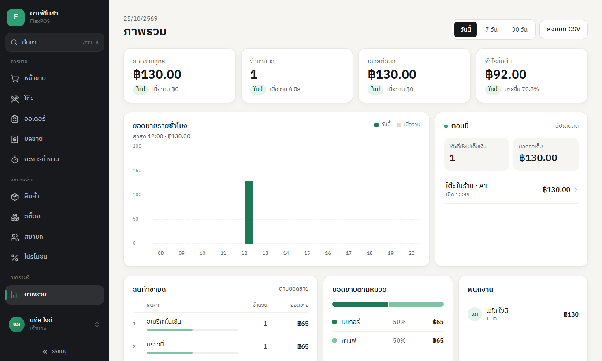


---

## 12. ดูแลระบบ: สำรองข้อมูล อัปเดต License

### สำรองและกู้คืน

- ระบบสำรองอัตโนมัติตามที่ตั้งไว้ในข้อ 6.12 ตรวจสัปดาห์ละครั้งว่ามีไฟล์ใหม่เกิดขึ้นจริง
- **กู้คืน**: ตั้งค่า → สำรองข้อมูล → เลือกไฟล์ → กู้คืน ระบบจะสำรองข้อมูลปัจจุบันไว้ก่อนให้อัตโนมัติ
- ย้ายไปเครื่องใหม่: สำรองที่เครื่องเดิม → ติดตั้งเครื่องใหม่ → กู้คืนจากไฟล์

### อัปเดตเป็นเวอร์ชันใหม่

ข้อมูลของร้านอยู่ในโฟลเดอร์ `data` ซึ่งไม่ถูกแตะตอนอัปเดต แต่ให้สำรองข้อมูลก่อนทุกครั้ง

1. กด **สำรองตอนนี้**
2. ปิดหน้าต่าง `start.bat`
3. เปิด Command Prompt ในโฟลเดอร์ FlexPOS แล้วรัน

   ```bash
   git pull
   ```

   (ถ้าดาวน์โหลดเป็น ZIP ให้ดาวน์โหลดใหม่แล้วแตกทับ **โดยไม่ลบโฟลเดอร์ `data`**)

4. ดับเบิลคลิก `install.bat` แล้ว `start.bat` อีกครั้ง

### ล้างข้อมูลทดลองก่อนเปิดร้าน

ถ้าทดลองขายด้วยข้อมูลตัวอย่างแล้วต้องการเริ่มร้านจริงแบบสะอาด

1. ปิดหน้าต่าง `start.bat`
2. เปลี่ยนชื่อโฟลเดอร์ `data` เป็น `data-ทดลอง` (เก็บไว้ก่อน อย่าเพิ่งลบ)
3. เปิด `start.bat` อีกครั้ง ระบบจะเริ่มตัวช่วยตั้งค่าร้านใหม่ เลือก **เริ่มจากร้านว่าง**
4. ถ้ามี License key แล้ว ให้ใส่ใหม่อีกครั้ง

### License

ดูวันหมดอายุ จำนวนเครื่องและสาขาที่ใช้ได้ที่ **ตั้งค่า → License** เปลี่ยนเครื่องใหม่ต้องขอ key ใหม่จากผู้จำหน่าย (Machine ID เปลี่ยน)

---

## 13. แก้ปัญหาที่พบบ่อย

| อาการ | วิธีแก้ |
|---|---|
| `install.bat` แจ้งไม่พบ Node.js | ติดตั้ง Node.js 20+ จาก nodejs.org แล้ว **ปิดและเปิด** หน้าต่างใหม่ |
| `install.bat` ค้างหรือ error ตอนติดตั้งแพ็กเกจ | ตรวจอินเทอร์เน็ต แล้วรันใหม่ ถ้ายังไม่ได้ ลบโฟลเดอร์ `node_modules` แล้วรันอีกครั้ง |
| เปิด <http://localhost:4100> ไม่ได้ | ตรวจว่าหน้าต่าง `start.bat` ยังเปิดอยู่ และไม่มีโปรแกรมอื่นใช้พอร์ต 4100 |
| แท็บเล็ต/มือถือเชื่อมไม่ได้ | อยู่ Wi-Fi วงเดียวกันหรือไม่, อนุญาต Node.js ใน Windows Firewall (Private), ใช้ IP จากหน้า อุปกรณ์และเครือข่าย |
| ที่อยู่เครื่องหลักเปลี่ยนบ่อย | ตั้ง IP คงที่ (DHCP reservation) ให้เครื่องหลักที่เราเตอร์ |
| พิมพ์ภาษาไทยเพี้ยน | ตั้งค่า → เครื่องพิมพ์ → เลือก **โหมดภาพ** |
| เครื่องพิมพ์ไม่พิมพ์ | ตรวจ IP และสาย LAN, กดทดสอบพิมพ์ ใบที่พิมพ์ไม่สำเร็จจะเข้าคิวและพิมพ์เองเมื่อเครื่องพิมพ์กลับมา |
| สแกน QR แล้วชื่อบัญชีไม่ถูก | ตรวจหมายเลข PromptPay ที่ ตั้งค่า → บัญชีรับเงิน |
| ลืม PIN | ให้เจ้าของ/ผู้จัดการเปลี่ยน PIN ที่ ตั้งค่า → พนักงาน |
| ลืมรหัสผ่านเจ้าของ | เข้าด้วย PIN เจ้าของ แล้วเปลี่ยนรหัสผ่านที่ ตั้งค่า → พนักงาน |
| ทดลองใช้หมดอายุ บันทึกการขายไม่ได้ | ใส่ License key ที่ ตั้งค่า → License |
| เน็ตหลุดระหว่างขาย (เครื่องลูก) | ขายต่อได้ บิลจะขึ้น "รอส่ง" และส่งเองเมื่อกลับมาออนไลน์ |

---

## 14. เช็กลิสต์ก่อนเปิดขายจริง

- [ ] ติดตั้งแล้ว เปิด `start.bat` ได้ และตั้งให้เปิดเองเมื่อเปิดเครื่อง
- [ ] ข้อมูลร้าน ที่อยู่ เลขผู้เสียภาษี ถูกต้องบนใบเสร็จ
- [ ] ตั้ง VAT และค่าบริการถูกต้อง
- [ ] เพิ่มบัญชีรับเงิน และสแกน QR ทดสอบแล้วชื่อบัญชีถูก
- [ ] เปิดวิธีชำระเงินที่ร้านรับจริง
- [ ] เครื่องพิมพ์ใบเสร็จและครัวพิมพ์ทดสอบได้ ภาษาไทยไม่เพี้ยน
- [ ] สร้างโซนและโต๊ะครบ (ร้านอาหาร)
- [ ] เพิ่มพนักงานทุกคนพร้อม PIN และตรวจสิทธิ์แต่ละบทบาท
- [ ] เพิ่มสินค้าครบ ราคาถูกต้อง สแกนบาร์โค้ดได้
- [ ] แท็บเล็ต มือถือพนักงาน และจอลูกค้าเชื่อมได้
- [ ] ตั้งสำรองข้อมูลไปไดรฟ์อื่น และกดสำรองตอนนี้สำเร็จ
- [ ] ใส่ License key แล้ว
- [ ] ทดลองขายครบทุกวิธีชำระ รวมทั้งคืนสินค้า และปิดกะ 1 รอบ
- [ ] ถ้าทดลองขายด้วยข้อมูลตัวอย่าง: ล้างข้อมูลทดลองตามข้อ 12 ก่อนเปิดร้าน เพื่อไม่ให้ยอดทดลองปนในรายงาน

พร้อมเปิดขายแล้ว
